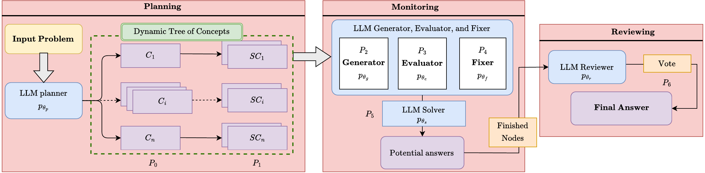

# MDToC: Metacognitive Dynamic Tree of Concepts for Boosting Mathematical Problem-Solving of Large Language Models

Tung Duong Ta, Tim Oates, Thien Van Luong, Huan Vu, Tien Cuong Nguyen

Published in the **Journal on Information Technologies & Communications (ICT Research)**, Vol. 28, No. 2, pp. 59–68, September 2026.

[Paper (journal)](https://ictmag.ictvietnam.vn/ict/issue/view/109) | [PDF (full issue, pp. 59–68)](https://ictmag.ictvietnam.vn/ict/issue/view/109/33) | [DOI: 10.31276/ICT.2026.0056](https://doi.org/10.31276/ICT.2026.0056) | [arXiv: 2512.18841](https://arxiv.org/abs/2512.18841)

## Overview



MDToC (Metacognitive Dynamic Tree of Concepts) is a three-phase prompting technique built on the metacognitive stages of planning, monitoring, and reviewing.

1. **Planning.** An LLM planner constructs a dynamic tree of concepts (C) and sub-concepts (SC) for the input problem.
2. **Monitoring.** An LLM generator, evaluator, and fixer develop accuracy-verified calculations for each concept. An LLM solver then produces potential answers.
3. **Reviewing.** An LLM reviewer employs majority voting to evaluate competing solutions and select the final answer.

## Results

MDToC is evaluated on three mathematical benchmarks: CHAMP, MATH, and Game-of-24.

| Backbone | CHAMP | MATH | Game-of-24 |
|---|---|---|---|
| GPT-4-Turbo + MDToC | 58.1% | 86.6% | 85% |
| Gain over GoT | +5% | +5.4% | +4% |

MDToC consistently matches or surpasses existing prompting methods across all backbone models, with improvements of up to 19% over ToT and 13% over GoT. It needs no hand-engineered hints. Delegating auxiliary components to lighter models reduces cost while maintaining accuracy.

## Abstract

Despite advances in mathematical reasoning capabilities, Large Language Models (LLMs) still struggle with calculation verification when using established prompting techniques. Chain-of-Thought prompting and its self-consistency variant lack evaluation of intermediate reasoning steps. Hierarchical techniques such as Tree-of-Thoughts (ToT) and Graph-of-Thoughts (GoT) evaluate abstract thoughts, which are difficult to score reliably. We present MDToC (Metacognitive Dynamic Tree of Concepts), a three-phase prompting technique built on the metacognitive stages of planning, monitoring, and reviewing. MDToC constructs a concept tree, develops accuracy-verified calculations for each concept, and employs majority voting to evaluate competing solutions. Evaluations across CHAMP, MATH, and Game-of-24 benchmarks demonstrate our MDToC's effectiveness, with GPT-4-Turbo achieving 58.1% on CHAMP, 86.6% on MATH, and 85% on Game-of-24, outperforming GoT by 5%, 5.4%, and 4% on all these tasks, respectively, without hand-engineered hints. MDToC consistently matches or surpasses existing prompting methods across all backbone models, yielding improvements of up to 19% over ToT and 13% over GoT. In addition, delegating auxiliary components to lighter models reduces cost while maintaining accuracy. These results establish metacognitive calculation verification as a promising direction for enhanced mathematical reasoning.

**Keywords:** Large Language Models, Mathematical Reasoning, Metacognition, Problem-Solving, Tree of Concepts

## Citation

```bibtex
@article{ta2026mdtoc,
  title   = {MDToC: Metacognitive Dynamic Tree of Concepts for Boosting Mathematical Problem-Solving of Large Language Models},
  author  = {Ta, Tung Duong and Oates, Tim and Luong, Thien Van and Vu, Huan and Nguyen, Tien Cuong},
  journal = {Journal on Information Technologies \& Communications (ICT Research)},
  volume  = {28},
  number  = {2},
  pages   = {59--68},
  year    = {2026},
  month   = sep,
  doi     = {10.31276/ICT.2026.0056}
}
```

## Contact

Tung Duong Ta, University of Maryland, Baltimore County (dta1@umbc.edu)
